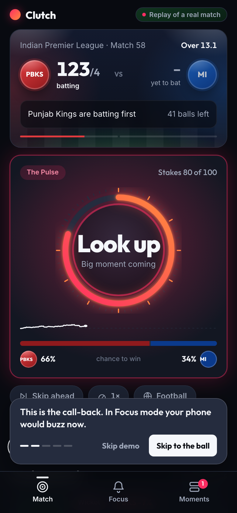
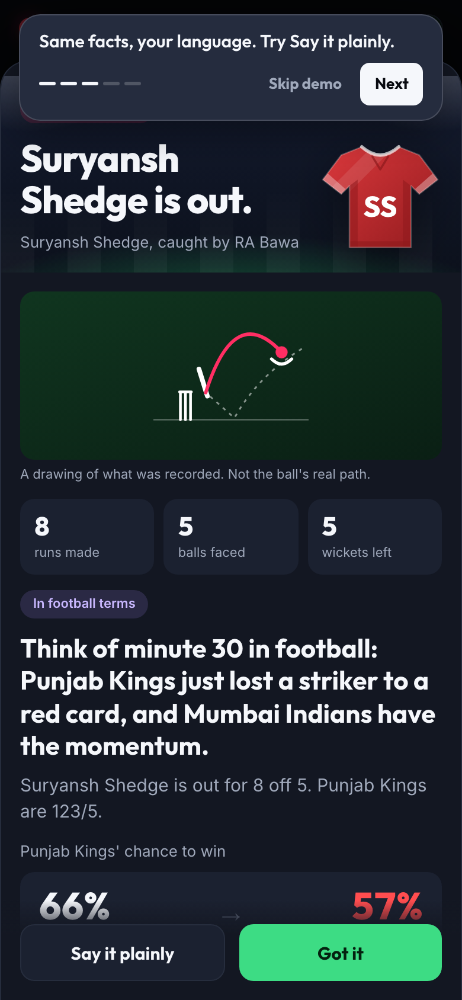
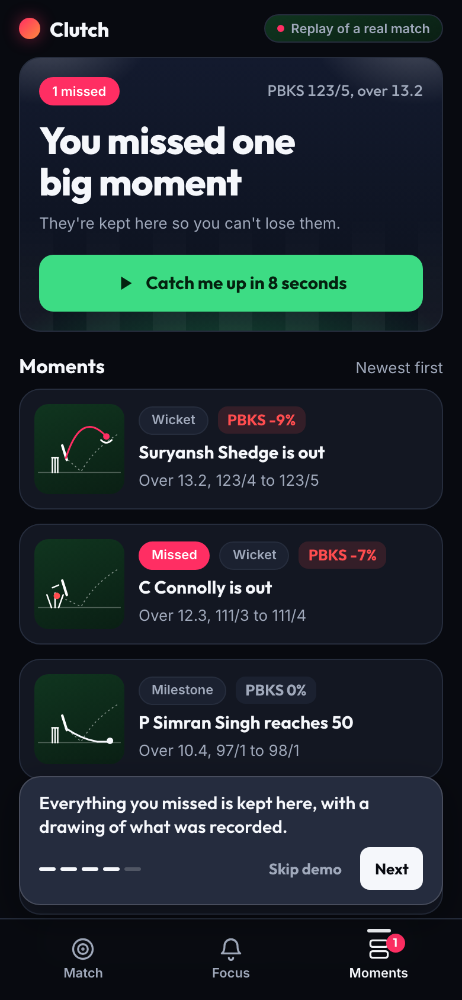
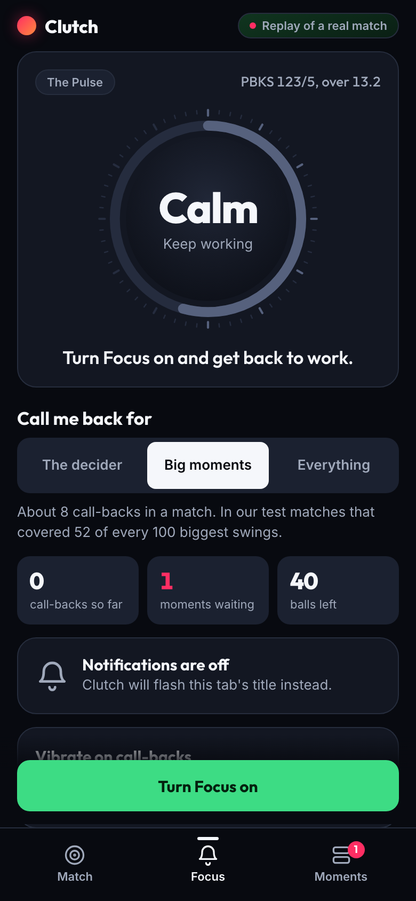
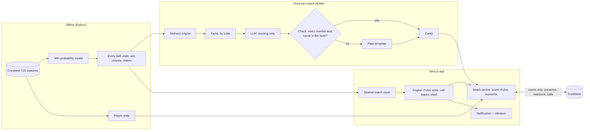

# Clutch

**The friend who tells you when to look up.**

A second screen for casual sports fans. Get on with your work: Clutch calls you back when a moment matters, shows you the one you missed, and explains why it mattered in the language of something you already love.

> **Status, 15 Nov 2026: tier 1 (watching alone) is built and runs locally. Tier 2 (rooms with friends) is designed, not built. Deployed at https://clutch-one-mu.vercel.app**
> Nothing here is live: the product replays one real past cricket match as if it were live. It has no real users, and its hypothesis is untested. No LLM key has been used yet, so every explanation card is a fixed template filled by code; the LLM path is built and tested with a fake provider only.

Built for the Dream11 Forward Deployed Engineer assignment: one AI-powered artifact that solves a real problem fans face during a live match.

<p>
  
  
  
  
</p>

*Screenshots of the deployed app at 390 by 844, taken by `scripts/demo-shots.mjs` against the live link. The match is Punjab Kings v Mumbai Indians, Indian Premier League, 2026-05-14, replayed from Cricsheet data. Every number on screen comes from the pipeline. The first design mock-ups are still in [`design/screens/`](design/screens/).*

## The problem, in my words

I don't follow cricket closely. I like the occasion more than the sport.

Often the match is on beside my laptop while I work. Nothing happens for a long time, so I look away. Then there's a catch or a six, I miss it, and by the time I look back the replay is gone and play has moved on.

When I watch with friends, a player walks in, everyone cheers, and I don't know who he is or why it matters. I can't keep asking "what just happened?", so I stop asking and end up on my phone.

Live sport is long stretches of nothing with a few seconds that matter, and nobody tells you which seconds. Score apps and commentary are made for people who already know the game.

## Hypothesis

> If a fan is called back **when** a moment matters, can see the moment they **missed**, and is told **why** it matters in terms they already understand, they stop missing the match and stop feeling like an outsider. They stay with it, alone or with friends, and come back for the next one.

This prototype can show that experience. It cannot prove the hypothesis: that needs real fans and real matches. A real product would measure minutes stayed per match, how often a call-back is followed by a look, and whether a casual fan returns for a second match.

## What it is

A match centre built like the sports apps fans already use, with one thing of its own: the Pulse.

- **The Pulse.** A ring that fills and pulses when the next ball could change the match, with one word that tells you what to do: Calm, Building, Look up, This is it. A win-probability model decides.
- **Focus mode.** Say you're working. Clutch goes quiet and calls you back only for moments above the bar you choose.
- **The Moment Shelf.** Every big moment is kept. Come back after two minutes or twenty and it says "You missed three", with a drawn replay of each and how far the win chance moved. "Catch me up" plays them in under a minute.
- **Your World.** Pick what you already love: football, F1, chess, Bollywood, gaming. Each moment is explained in those terms. The facts come from code; the LLM only chooses the words; code checks every number and name before you see it.
- **With friends** (tier 2). A room by 6-letter code, no sign-up. Everyone is on the same ball. Reactions, a call before each over (points only), and **Back me up**: your player's best true case against your friend's, fair to both sides.

## Built, and designed but not built

Tier 1 is finished before tier 2 starts. This table is updated as work lands.

| Tier | Feature | State |
|---|---|---|
| 1 | Shared match clock and score (replay) | built, solo. The shared part (two devices on one clock) needs rooms, which are not built |
| 1 | Win-probability model and stakes | built |
| 1 | The Pulse and Focus mode call-backs | built. Background-tab notification not yet checked by hand |
| 1 | Moment Shelf, drawn replay, Catch me up | built |
| 1 | Your World cards with the faithfulness check | built. Wording is template-only until an LLM key is used |
| 1 | Two-minute reviewer demo | built |
| 2 | Friends' room by code | designed, not built |
| 2 | Reactions | designed, not built |
| 2 | Per-over calls and leaderboard | designed, not built |
| 2 | Back me up | designed, not built |
| 3 | Voice room · floating mini Pulse · memento · spoiler guard · football adapter · roar trigger · push with the app closed | designed, not built |

## How it works



Offline, Python turns past matches into a model and writes the win chance and stakes for every ball of the replay match. A script finds the moments, builds the facts, asks the LLM for wording, checks it, and saves the cards. In the browser, a clock works out which ball is "now" from a start time, so every device agrees and a refresh loses nothing. Watching alone needs no database and no LLM at run time.

Three ideas carry the design:

1. **Facts by code, wording by LLM, checked by code.** A card that fails the check is never shown; the fan gets a plain template instead. ([CARDS.md](docs/CARDS.md))
2. **A clock, not a feed.** The match position is computed from an anchor time, so nothing has to push it. ([TRD.md](docs/TRD.md) §3)
3. **Built for any sport, shown on cricket.** The engine sees only `{state, event, stakes}`; cricket is one adapter. Only cricket is built. ([DECISIONS/0006](docs/DECISIONS/0006-sport-agnostic-engine-cricket-demo.md))

## Results

Each number is copied from the file named, not typed. Run on 14 and 15 Nov 2026.

| Question | Result | Source |
|---|---|---|
| Matches used (train / validation / test), split by date | 3,137 / 672 / 673 | `model/artifacts/split.json` |
| Model Brier score on test matches (lower is better) | 0.1533 for the shipped model, against 0.1926 for a run-rate rule and 0.2501 for a constant | `model/artifacts/metrics.json` |
| Share of each test match's 10 biggest swings that had a call-back in the over before | Only the decider 30% (random, same count: 10%) · Big moments 52% (random, same count: 22%) · Everything 82% (random, same count: 42%) | `model/artifacts/pulse_eval.json` |
| Call-backs per match (median) | 2 · 8 · 20 | same |
| Planted errors the check caught | 30 of 30, each by the rule it was planted for; 10 of 10 good cards passed | `evals/results/summary.json` |
| Recorded cards for the replay match that pass the check | 216 of 216, all templates | same |
| Cards passing the check first time when written by an LLM | not measured: no LLM key has been used | |
| Analogy quality by rubric; agreement with my own scoring | not measured: needs LLM-written cards | |
| Automated tests, run locally and in CI | 159 of 159 unit and integration · 33 Python · 13 end to end, all passing | `evals/results/tests.json` |

**Reading the Pulse numbers honestly.** At every bar the Pulse catches two to three times as many of the biggest swings as the same number of random call-backs. It is far from complete: at "Big moments", about half of a match's ten biggest swings had a call-back in the over before them. And "biggest swings" are measured with the same model that triggers the call-backs, so the absolute number is optimistic ([MODEL.md](docs/MODEL.md) section 8).

## Limits

- **It is a replay.** One real past match on a synthetic clock (the data has no ball timestamps). No live feed.
- **No real users.** The hypothesis is untested.
- **The model is simple.** It knows the score situation only, not who is batting. It is trained on public data and its accuracy will be reported as it is.
- **Call-backs need the page open** (in front or in a background tab). If a phone locks, they may be late or missing. On iPhone, notifications need the app added to the Home Screen. Push with the app closed is designed, not built.
- **The replay is a drawing.** The data records what happened, not where the ball went, so the drawing shows the kind of outcome only and says so.
- **Player stats cover only matches in our data,** and each card says how many.
- **The check is strict about numbers and names, not meaning.** An analogy can use no wrong number and still be a poor fit; that is measured by a rubric, not prevented.
- **Cricket only.** Other sports are an interface and a guide, not working code.

## Run it

Needs Node 22. No keys, no database.

```bash
npm install
```
```bash
npm run dev
```

**Try it:** open https://clutch-one-mu.vercel.app on a phone and tap **Show me in 2 minutes**. No sign-up, no permission prompt.

To run it yourself, open http://localhost:3000 after the commands above and tap **Show me in 2 minutes**. The match data, the model's numbers and the cards are committed in `data/`, so nothing has to be trained to run the app.

Checks:

```bash
npm run typecheck && npm run lint && npm test && npm run check-data && npm run evals:check
```
```bash
npm run e2e
```

To rebuild the model from Cricsheet (Python 3.11, about 100 MB of downloads): `make model-setup`, `make model`, `make model-test`. See [RUNBOOK.md](docs/RUNBOOK.md).

To have an LLM write the cards, put `LLM_PROVIDER=gemini`, `LLM_MODEL` and `LLM_API_KEY` in `.env.local` (never in the repository) and run `npm run pregen`, then `npm run evals:check`. This path is built and unit-tested with a fake provider; it has not been run against a real model yet.

**CI:** green on GitHub Actions for the first time on 15 Nov (lint, typecheck, unit tests, data check, evals check, build, Python tests and the 13 end-to-end tests). Before that, every run had failed at the start because of a mistake in the workflow file.

**Not checked yet:** a call-back notification in a background tab (needs a person to allow notifications; the live link is HTTPS, so it can be checked there), vibration on an Android phone, and an iPhone with the app on its Home Screen.

## Documents

| | |
|---|---|
| [PRD](docs/PRD.md) | User, problem, hypothesis, features with testable acceptance criteria |
| [DRD](docs/DRD.md) · [Design system](docs/DESIGN-SYSTEM.md) · [tokens](design/tokens.css) | Principles, every screen and state, components |
| [TRD](docs/TRD.md) | Architecture, clock, adapter, API, realtime protocol, SQL and row-level security |
| [MODEL](docs/MODEL.md) | The model, stakes, thresholds, and how the Pulse is evaluated |
| [CARDS](docs/CARDS.md) · [EVALS](docs/EVALS.md) | Moments, facts, prompt, the check, templates; how cards are evaluated |
| [TESTING](docs/TESTING.md) | Unit, integration and two-browser tests per feature |
| [DATA](docs/DATA.md) · [PRIVACY](docs/PRIVACY.md) · [RUNBOOK](docs/RUNBOOK.md) | Source and licence; what is stored; run, deploy, recover |
| [DECISIONS](docs/DECISIONS/) | Why replay, why facts by code, why no faces, how the design changed, and more |
| [BUILD-PLAN](docs/BUILD-PLAN.md) | Ordered tasks, tests first, and the cut order |
| [AI-WORKFLOW](docs/AI-WORKFLOW.md) | Which AI tools did what, and what I decided and reviewed |

## How this was built

The idea is my own, and I built it with AI. Claude Code (Anthropic) wrote most of the code, tests and documents under the rules in `CLAUDE.md`; I directed it, reviewed every change and study it so I can explain every part. The full account, including what I rejected and what the AI got wrong, is in [AI-WORKFLOW.md](docs/AI-WORKFLOW.md). The agent's rules, skills, reviewers and guard hooks are in [`CLAUDE.md`](CLAUDE.md) and [`.claude/`](.claude/).

## Data and credits

Match data from [Cricsheet](https://cricsheet.org), used under the [Open Data Commons Attribution License v1.0](https://opendatacommons.org/licenses/by/1-0/). Processed files in `data/` are adapted from it and carry the same licence. Details in [DATA.md](docs/DATA.md).

Clutch never draws or generates a real player; players are shown as jerseys. The match video is the original stream, embedded in YouTube's player with credit to the channel, never downloaded or clipped. No betting, money or prizes.

Pranay Sarkar
