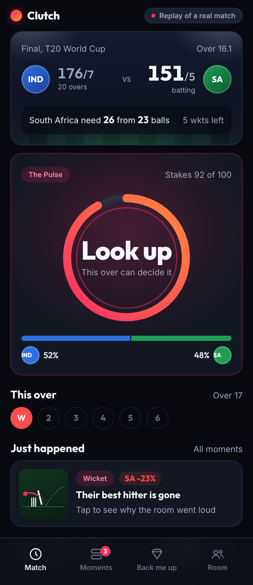
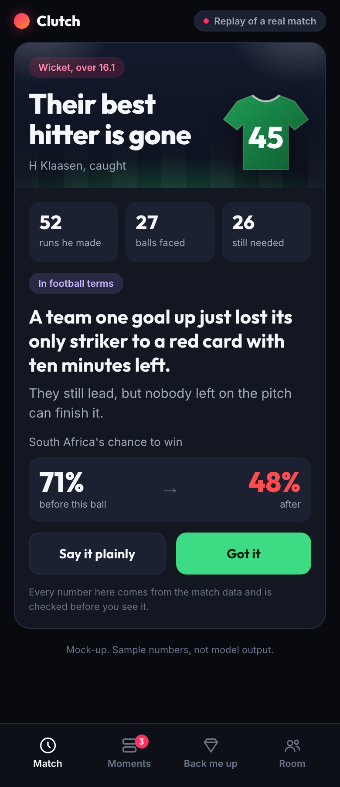
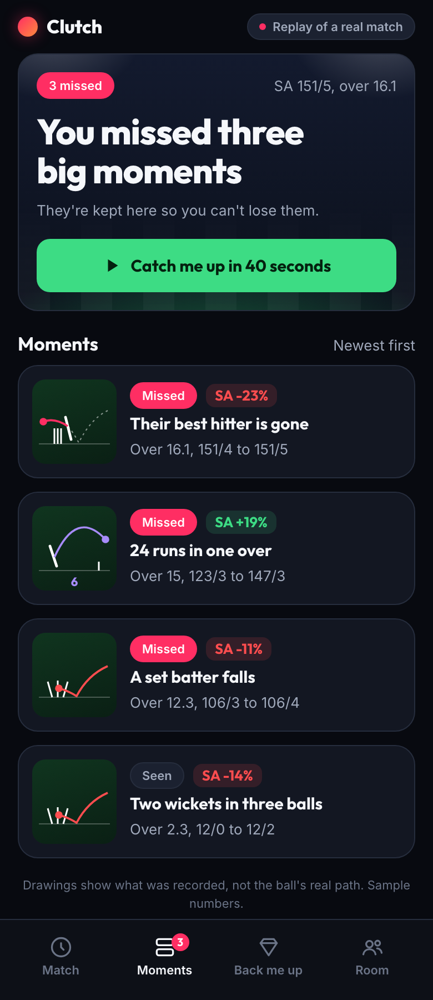
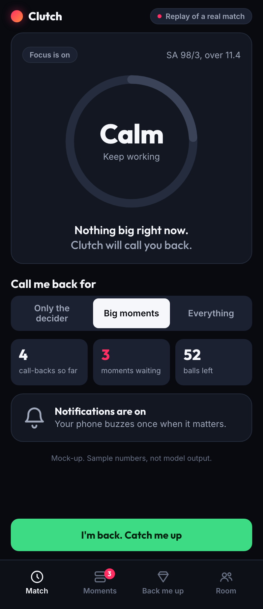
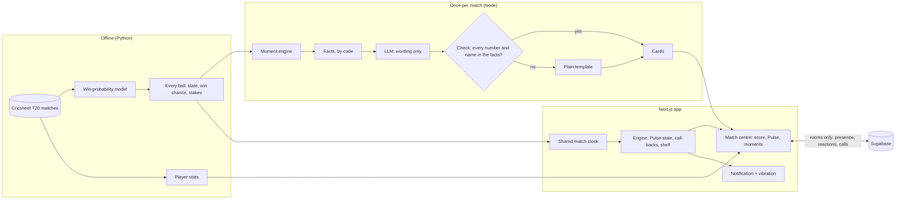

# Clutch

**The friend who tells you when to look up.**

A second screen for casual sports fans. Get on with your work: Clutch calls you back when a moment matters, shows you the one you missed, and explains why it mattered in the language of something you already love.

> **Status, 13 Nov 2026: documents and design only. No feature code yet.**
> Every result below says "to be measured" until the pipeline produces it. Nothing here is live: the product replays one real past cricket match as if it were live. It has no real users, and its hypothesis is untested.

Built for the Dream11 Forward Deployed Engineer assignment: one AI-powered artifact that solves a real problem fans face during a live match.

<p>
  
  
  
  
</p>

*Design mock-ups (static HTML in [`design/screens/`](design/screens/)), not the running app. Numbers in them are samples, not model output.*

## The problem, in my words

I don't follow cricket closely. I like the occasion more than the sport.

Often the match is on beside my laptop while I work. Nothing happens for a long time, so I look away. Then there's a catch or a six, I miss it, and by the time I look back the replay is gone and play has moved on.

When I watch with friends, a player walks in, everyone cheers, and I don't know who he is or why it matters. I can't keep asking "what just happened?", so I stop asking and end up on my phone.

Live sport is long stretches of nothing with a few seconds that matter, and nobody tells you which seconds. Score apps and commentary are made for people who already know the game.

## Hypothesis

> If a fan is called back **when** a moment matters, can see the moment they **missed**, and is told **why** it matters in terms they already understand, they stop missing the match and stop feeling like an outsider. They stay with it, alone or with friends, and come back for the next one.

This prototype can show that experience. It cannot prove the hypothesis: that needs real fans and real matches. A real product would measure minutes stayed per match, how often a call-back is followed by a look, and whether a casual fan returns for a second match.

## What it is

A match centre built like the sports apps fans already use, with one thing of its own: the Pulse.

- **The Pulse.** A ring that fills and pulses when the next ball could change the match, with one word that tells you what to do: Calm, Building, Look up, This is it. A win-probability model decides.
- **Focus mode.** Say you're working. Clutch goes quiet and calls you back only for moments above the bar you choose.
- **The Moment Shelf.** Every big moment is kept. Come back after two minutes or twenty and it says "You missed three", with a drawn replay of each and how far the win chance moved. "Catch me up" plays them in under a minute.
- **Your World.** Pick what you already love: football, F1, chess, Bollywood, gaming. Each moment is explained in those terms. The facts come from code; the LLM only chooses the words; code checks every number and name before you see it.
- **With friends** (tier 2). A room by 6-letter code, no sign-up. Everyone is on the same ball. Reactions, a call before each over (points only), and **Back me up**: your player's best true case against your friend's, fair to both sides.

## Built, and designed but not built

Tier 1 is finished before tier 2 starts. This table is updated as work lands; today nothing is built.

| Tier | Feature | State |
|---|---|---|
| 1 | Shared match clock and score (replay) | not built yet |
| 1 | Win-probability model and stakes | not built yet |
| 1 | The Pulse and Focus mode call-backs | not built yet |
| 1 | Moment Shelf, drawn replay, Catch me up | not built yet |
| 1 | Your World cards with the faithfulness check | not built yet |
| 1 | Two-minute reviewer demo | not built yet |
| 2 | Friends' room by code | not built yet |
| 2 | Reactions | not built yet |
| 2 | Per-over calls and leaderboard | not built yet |
| 2 | Back me up | not built yet |
| 3 | Voice room · floating mini Pulse · memento · spoiler guard · football adapter · roar trigger · push with the app closed | designed, not built |

## How it works



Offline, Python turns past matches into a model and writes the win chance and stakes for every ball of the replay match. A script finds the moments, builds the facts, asks the LLM for wording, checks it, and saves the cards. In the browser, a clock works out which ball is "now" from a start time, so every device agrees and a refresh loses nothing. Watching alone needs no database and no LLM at run time.

Three ideas carry the design:

1. **Facts by code, wording by LLM, checked by code.** A card that fails the check is never shown; the fan gets a plain template instead. ([CARDS.md](docs/CARDS.md))
2. **A clock, not a feed.** The match position is computed from an anchor time, so nothing has to push it. ([TRD.md](docs/TRD.md) §3)
3. **Built for any sport, shown on cricket.** The engine sees only `{state, event, stakes}`; cricket is one adapter. Only cricket is built. ([DECISIONS/0006](docs/DECISIONS/0006-sport-agnostic-engine-cricket-demo.md))

## Results

All blank until measured. Each number will be copied from the file named, not typed.

| Question | Result | Source |
|---|---|---|
| Matches used (train / validation / test) | to be measured | `model/artifacts/split.json` |
| Model Brier score on test matches, vs a run-rate baseline | to be measured | `model/artifacts/metrics.json` |
| Share of each test match's 10 biggest swings that got a call-back first, per Focus bar | to be measured | `model/artifacts/pulse_eval.json` |
| Call-backs per match, per Focus bar | to be measured | same |
| Cards passing the faithfulness check first time | to be measured | `evals/results/summary.json` |
| Planted errors the check caught | to be measured | same |
| Analogy quality by rubric; agreement with my own scoring of 30 cards | to be measured | same |
| Automated tests | to be measured | CI |

## Limits

- **It is a replay.** One real past match on a synthetic clock (the data has no ball timestamps). No live feed.
- **No real users.** The hypothesis is untested.
- **The model is simple.** It knows the score situation only, not who is batting. It is trained on public data and its accuracy will be reported as it is.
- **Call-backs need the page open** (in front or in a background tab). If a phone locks, they may be late or missing. On iPhone, notifications need the app added to the Home Screen. Push with the app closed is designed, not built.
- **The replay is a drawing.** The data records what happened, not where the ball went, so the drawing shows the kind of outcome only and says so.
- **Player stats cover only matches in our data,** and each card says how many.
- **The check is strict about numbers and names, not meaning.** An analogy can use no wrong number and still be a poor fit; that is measured by a rubric, not prevented.
- **Cricket only.** Other sports are an interface and a guide, not working code.

## Run it

Nothing to run yet beyond the mock-ups: open any file in `design/screens/` in a browser at phone width.

Once the first build task is done, see [RUNBOOK.md](docs/RUNBOOK.md):

```bash
npm install
```
```bash
npm run dev
```

Watching alone needs no keys. Rooms need a Supabase project; card wording needs one LLM key. Both go in `.env.local`, never in the repository.

## Documents

| | |
|---|---|
| [PRD](docs/PRD.md) | User, problem, hypothesis, features with testable acceptance criteria |
| [DRD](docs/DRD.md) · [Design system](docs/DESIGN-SYSTEM.md) · [tokens](design/tokens.css) | Principles, every screen and state, components |
| [TRD](docs/TRD.md) | Architecture, clock, adapter, API, realtime protocol, SQL and row-level security |
| [MODEL](docs/MODEL.md) | The model, stakes, thresholds, and how the Pulse is evaluated |
| [CARDS](docs/CARDS.md) · [EVALS](docs/EVALS.md) | Moments, facts, prompt, the check, templates; how cards are evaluated |
| [TESTING](docs/TESTING.md) | Unit, integration and two-browser tests per feature |
| [DATA](docs/DATA.md) · [PRIVACY](docs/PRIVACY.md) · [RUNBOOK](docs/RUNBOOK.md) | Source and licence; what is stored; run, deploy, recover |
| [DECISIONS](docs/DECISIONS/) | Why replay, why facts by code, why no faces, how the design changed, and more |
| [BUILD-PLAN](docs/BUILD-PLAN.md) | Ordered tasks, tests first, and the cut order |
| [AI-WORKFLOW](docs/AI-WORKFLOW.md) | Which AI tools did what, and what I decided and reviewed |

## How this was built

With AI coding agents, on purpose and in the open. The fan problem, the hypothesis and the product decisions are mine. Research, planning, design mock-ups and most of the code are AI-assisted, and I review and study all of it. The full account, including what I rejected and what the AI got wrong, is in [AI-WORKFLOW.md](docs/AI-WORKFLOW.md). The agent's rules, skills, reviewers and guard hooks are in [`CLAUDE.md`](CLAUDE.md) and [`.claude/`](.claude/).

## Data and credits

Match data from [Cricsheet](https://cricsheet.org), used under the [Open Data Commons Attribution License v1.0](https://opendatacommons.org/licenses/by/1-0/). Processed files in `data/` are adapted from it and carry the same licence. Details in [DATA.md](docs/DATA.md).

No real player's face or likeness is used anywhere; players are shown as jerseys. No video. No betting, money or prizes.

Pranay Sarkar
