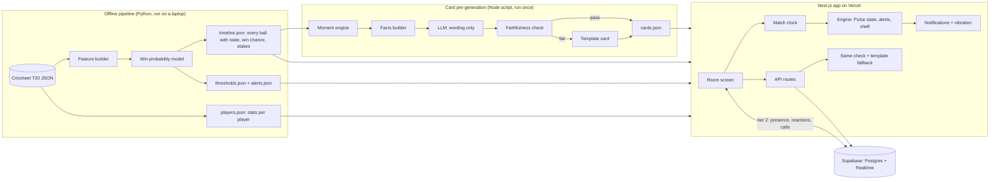

# Clutch: technical requirements

Status: design only. No feature code exists yet. Build order is in [BUILD-PLAN.md](BUILD-PLAN.md).

## 1. Architecture



**How to read it.** Offline, Python turns past matches into a model and writes one file per replay match with the win chance and stakes for every ball. A Node script then finds the moments, builds the facts for each, asks the LLM for wording, checks it, and saves the cards. The app ships those files as static data. In the browser, a clock decides which ball is "now", the engine turns that into the Pulse state, alerts and the shelf, and cards are looked up. Supabase is only used when friends share a room.

**The key property:** tier 1 (solo) has no database and no runtime LLM dependency. If Supabase and the LLM are both down, the demo still works.

### Stack

| Part | Choice |
|---|---|
| App | Next.js (App Router), TypeScript strict, Tailwind v4, installable as a PWA |
| Hosting | Vercel (Hobby) |
| Room (tier 2) | Supabase: Postgres, Realtime (Broadcast + Presence), anonymous sign-in, row-level security |
| Model | Python 3.11+, pandas, scikit-learn, pytest. Runs offline, never in production |
| LLM | One provider behind `lib/llm/` (section 9). Default Gemini; swap by env var |
| Validation | Zod for every API body and every LLM output |
| Tests | Vitest (unit, integration), Playwright (two browsers), pytest (model) |
| CI | GitHub Actions |

Use the current stable versions at build time and look up their docs first; do not write framework code from memory.

### Repository layout (target)

```
app/                      routes and pages
  api/                    route handlers (section 5)
components/               UI components (names from DESIGN-SYSTEM.md)
lib/
  clock/                  match clock (section 3)
  engine/                 sport-agnostic: pulse state, alerts, shelf, calls scoring
  adapters/cricket/       the only sport-specific code (section 4)
  cards/                  moments, facts, prompt, check, templates (CARDS.md)
  llm/                    provider interface
  room/                   Supabase client, channel protocol (section 6)
  notify/                 notifications, vibration, title flash
data/matches/<match_id>/  timeline.json, alerts.json, moments.json, cards.json, players.json
data/thresholds.json
model/                    Python pipeline: src/, tests/, artifacts/
scripts/                  pregen-cards.ts, check-data.ts
evals/                    cases/, outputs/, results/ (EVALS.md)
e2e/                      Playwright tests
supabase/migrations/      SQL from section 7
design/                   tokens.css, mock-ups
docs/
```

## 2. Data contracts (static files)

Produced by the pipeline, read by the app. Types live in `lib/engine/types.ts` and are validated with Zod when loaded.

### `data/matches/<match_id>/timeline.json`

```json
{
  "match": {
    "id": "1415755",
    "sport": "cricket",
    "format": "T20",
    "date": "2024-06-29",
    "venue": "…",
    "city": "…",
    "event": { "name": "…", "stage": "…" },
    "squads": { "IND": ["…"], "SA": ["…"] },
    "teams": [
      { "code": "IND", "name": "India", "colors": ["#2f6fe0", "#ffffff"] },
      { "code": "SA", "name": "South Africa", "colors": ["#1f8a4c", "#ffffff"] }
    ],
    "batting_order": ["IND", "SA"],
    "result": { "winner": "IND", "by": { "runs": 7 } },
    "source": "Cricsheet",
    "licence": "ODC-By 1.0"
  },
  "events": [
    {
      "i": 0,
      "t_ms": 0,
      "event": {
        "innings": 1, "over": 0, "ball": 1, "legal": true,
        "batter": "RG Sharma", "bowler": "M Jansen", "non_striker": "V Kohli",
        "runs": { "bat": 4, "extras": 0, "total": 4 },
        "extras_kind": null,
        "wicket": null
      },
      "state": {
        "batting": "IND", "score": 4, "wickets": 0,
        "balls_bowled": 1, "balls_left": 119,
        "target": null, "needed": null, "crr": 24.0, "rrr": null
      },
      "wp": { "team": "IND", "before": 0.0, "after": 0.0 },
      "stakes": { "raw": 0.0, "pct": 0 }
    }
  ]
}
```

- `i` is the event index, 0-based, across both innings.
- `t_ms` is the replay time of the event (section 3.1).
- `state` is the state **after** the event. `stakes` is computed from the state **before** it (what was at risk on this ball).
- `wp` is the win chance of `match.batting_order[0]` (the team that batted first), before and after the ball. One team's view throughout, so swings have a consistent sign.
- `stakes.pct` is 0 to 100: the percentile of `stakes.raw` among all balls in the training set, to one decimal place.
- `event.ball` is the ball's number in the over (1 to 6). A wide or no-ball carries the number of the ball that has to be bowled again.
- `squads` lists each side's players for this match, by team code. Team colours and codes are typed in `data/teams.json`; a team not listed there gets a code from its initials and the default colours.
- Names are Cricsheet's names. The example values above are placeholders; real values come from the pipeline.
- `wicket`, when present: `{ "kind": "caught", "player_out": "…", "fielders": ["…"] }`.

### `data/thresholds.json`

```json
{
  "fitted_on": "train",
  "fitted_at": "2026-11-14",
  "pulse": { "building": 0, "high": 0, "decider": 0 },
  "alert": { "notable": 0, "big": 0, "decider": 0, "cooldown_balls": 0 },
  "moment": { "min_swing": 0.0 }
}
```

All zeros until the pipeline writes real values. `pulse.*` and `alert.*` are `stakes.pct` cut-offs. See [MODEL.md](MODEL.md) section 6.

### `data/matches/<match_id>/alerts.json`

```json
[{ "i": 187, "bar": "big", "line": "This over can decide it" }]
```

One entry per call-back, at its level (the highest bar the ball's stakes reach). A fan at bar "notable" gets all entries; at "big" gets `big` and `decider`; at "decider" gets only `decider`. Written by the pipeline using the rule in MODEL.md section 6, so the app and the evaluation use the same alerts.

### `moments.json`, `cards.json`, `players.json`

Defined in [CARDS.md](CARDS.md) sections 1, 4 and 7.

## 3. The match clock

The clock answers one question: **which event is "now"?** It is a pure function. No server job advances the match.

### 3.1 The replay timeline

Cricsheet has no time for each ball, so the pipeline builds one with fixed gaps:

| After | Gap before the next ball |
|---|---|
| Any ball | 30 s |
| The last ball of an over | 30 + 45 = 75 s |
| A wicket | add 60 s |
| The end of innings 1 | 120 s (a short break; a real one is longer) |

`t_ms` of event 0 is 0. Each later `t_ms` is the previous `t_ms` plus the gap. A T20 runs about three hours at speed 1. These gaps are a design choice, stated in the README; they are not the real match's timing.

### 3.2 The anchor

A session's clock is three numbers:

```ts
type Anchor = {
  anchor_at: number;         // server time in ms when the anchor was set
  anchor_elapsed_ms: number; // match time at that instant
  speed: number;             // 1 = real time, 0 = paused
};
```

```ts
elapsed(now)  = anchor_elapsed_ms + (now - anchor_at) * speed
indexAt(now)  = the largest i with events[i].t_ms <= elapsed(now)   // -1 before the first ball
finished(now) = elapsed(now) > events[last].t_ms + 30_000
```

`indexAt` uses binary search over `t_ms`. Any change (skip, speed, pause) writes a **new anchor**: `anchor_at = now`, `anchor_elapsed_ms = the new match time`, `speed = the new speed`. There is never a second code path.

- **Solo:** the anchor lives in `localStorage`. `now` is `Date.now()`.
- **Room:** the anchor lives in the `rooms` row. `now` is server time, estimated as below, so devices with wrong clocks still agree.

### 3.3 Server time

Each client estimates the gap between its clock and the server's:

```
t0 = Date.now()
server = (GET /api/time).now
t1 = Date.now()
offset = server - (t0 + t1) / 2
serverNow() = Date.now() + offset
```

Take three samples at start and keep the one with the smallest `t1 - t0`. Re-sample when the tab becomes visible again.

### 3.4 The ticker

A Web Worker posts a tick every 250 ms. On each tick the page computes `indexAt(serverNow())` and, if the index changed, updates state. Workers are throttled less than page timers in background tabs, which Focus mode needs. On `visibilitychange` to visible, recompute at once.

When the index jumps by more than one (background tab, sleep, skip), the engine processes every skipped event in order so no moment or alert is lost; alerts older than 20 seconds are not fired as notifications, they only land on the shelf.

### 3.5 Worked examples

**A. Normal play, device clock wrong.** The room anchor is `anchor_at = 19:00:00.000`, `anchor_elapsed_ms = 0`, `speed = 1`. A phone's clock is 2.4 s fast. It samples: `t0 = 19:00:12.400` (its clock), server replies `19:00:10.050`, `t1 = 19:00:12.500`. Offset = 19:00:10.050 − 19:00:12.450 = −2.400 s. Later the phone's clock reads 19:03:02.400, so `serverNow` = 19:03:00.000 and `elapsed` = 180 000 ms. Event times in the first over are 0, 30, 60, 90, 120, 150 s and the next over starts at 225 s. The largest `t_ms` ≤ 180 000 is 150 000, so `indexAt` = 5 (the sixth ball). A second phone with a correct clock computes the same 180 000 and the same index.

**B. Refresh.** The page reloads at server time 19:03:10. It fetches the room row (same anchor), re-estimates the offset, and computes `elapsed` = 190 000, index 5. Nothing was stored about "current ball", so nothing can be lost.

**C. Skip to the next big moment.** At `elapsed` = 180 000 the reviewer taps Skip. The next moment is at event 61 with `t_ms` = 1 935 000. The target is 8 s before it: 1 927 000. The new anchor is `anchor_at = now`, `anchor_elapsed_ms = 1 927 000`, `speed = 1`. In a room the server writes this and broadcasts it; every device jumps together. Events 6 to 60 are processed in order: their moments go to the shelf as "missed", no notifications fire.

**D. Speed.** At `elapsed` = 600 000 the host sets speed 4. New anchor: `anchor_at = now`, `anchor_elapsed_ms = 600 000`, `speed = 4`. Thirty real seconds later `elapsed` = 600 000 + 30 000 × 4 = 720 000. Because the anchor was re-based, time before the change is unaffected.

**E. Before the start and after the end.** `elapsed` = −5 000 (room opened with a 5 s countdown) gives index −1: the "Soon" state. `elapsed` beyond the last `t_ms` + 30 s gives `finished`.

## 4. The sport adapter

The engine never mentions cricket. It works on ticks:

```ts
type Stakes = { raw: number; pct: number };          // pct: 0..100
type WinChance = { team: string; before: number; after: number };

type Tick<S, E> = {
  i: number;
  t_ms: number;
  state: S;        // after the event
  event: E;
  stakes: Stakes;  // what was at risk on this event
  wp: WinChance;
};

type ScoreboardView = {
  rows: { team: string; main: string; sub: string; side: string; batting: boolean }[];
  chase?: { left: string; right: string };           // "26 runs needed from 23 balls", "5 wickets left"
};

interface SportAdapter<S, E> {
  sport: string;
  load(matchId: string): Promise<{ match: MatchInfo; ticks: Tick<S, E>[] }>;
  scoreboard(state: S, match: MatchInfo): ScoreboardView;
  eventGlyph(event: E): string;                       // "W", "6", "4", "1", "•"
  segment(ticks: Tick<S, E>[], i: number): { label: string; cells: string[] }; // the "this over" strip
  detectMoments(ticks: Tick<S, E>[], thresholds: Thresholds): Moment[];
  facts(moment: Moment, ticks: Tick<S, E>[], match: MatchInfo): Facts;
  anchors(moment: Moment, ticks: Tick<S, E>[], world: World): Record<string, number>;
  replayKind(event: E): ReplayKind;                   // which mini-replay drawing to use
}
```

What is shared across sports: the clock, Pulse state, alerts, the shelf, seen and missed, cards (prompt, check, cache), the room, reactions, calls scoring.

What a new sport must supply: a pipeline that writes `timeline.json` in the same shape with its own `state` and `event`, a win-probability model for `wp` and `stakes`, and one adapter module. A guide for adding a sport is `lib/adapters/README.md` (build task). Only the cricket adapter is built. Football is designed, not built.

## 5. API contracts

All routes are Next.js route handlers under `app/api/`. Bodies are JSON, validated with Zod. Errors use one shape:

```json
{ "error": { "code": "room_not_found", "message": "No room with that code." } }
```

Codes: `bad_request` 400, `unauthorized` 401, `forbidden` 403, `room_not_found` 404, `too_late` 409, `rate_limited` 429, `unavailable` 503.

Tier 2 routes need `Authorization: Bearer <supabase access token>` from the anonymous session. The server verifies the token and uses the service-role key for writes. The service-role key never reaches the browser.

### Tier 1

**`GET /api/time`** → `200 { "now": 1794850210050 }`. No cache.

**`POST /api/card`**

```json
{ "match_id": "1415755", "moment_id": "m_187", "world": "football" }
```
→ `200`
```json
{
  "moment_id": "m_187",
  "world": "football",
  "kind": "swing",
  "headline": "Their best hitter is gone",
  "what": "…one fact line, from code…",
  "why": "…the analogy line…",
  "watch": "…or null…",
  "source": "pregen",
  "checked": true
}
```
`source` is one of `pregen` (from `cards.json`), `cache` (database or memory), `live` (generated now and passed the check), `template` (fallback). The route never returns an unchecked LLM card. Lookup order: `cards.json` → cache → LLM plus check → template. With no LLM key set it goes straight to template.

### Tier 2

**`POST /api/rooms`**
```json
{ "match_id": "1415755", "name": "Pranay", "world": "football" }
```
→ `201 { "room": { "id": "uuid", "code": "KXT4PM", "match_id": "1415755", "anchor_at": 1794850210050, "anchor_elapsed_ms": -5000, "speed": 1 }, "member": { "id": "uuid", "name": "Pranay", "is_host": true } }`

**`POST /api/rooms/join`**
```json
{ "code": "KXT4PM", "name": "Arjun", "world": "plain" }
```
→ `200` same shape, `is_host: false`. `404 room_not_found` for a wrong code. Rejoining with the same session returns the existing member.

**`POST /api/rooms/{id}/anchor`** (host only)
```json
{ "action": "skip_to_next_moment" }
```
or `{ "action": "set_speed", "speed": 4 }` or `{ "action": "restart" }`.
→ `200 { "anchor_at": 0, "anchor_elapsed_ms": 0, "speed": 1 }`. The server computes the new anchor with its own clock, writes the row, and broadcasts `anchor` on the room channel.

**`POST /api/calls`**
```json
{ "room_id": "uuid", "over_key": "2-17", "choice": "10_plus" }
```
`over_key` is `<innings>-<over number, 1-based>`. `choice` is `0_5`, `6_9` or `10_plus`.
→ `201 { "call": { "over_key": "2-17", "choice": "10_plus" } }`. `409 too_late` if the over's first ball is at or before the room's current index (the server computes the index from the anchor). One call per member per over; a second call before lock replaces the first.

**`GET /api/rooms/{id}/leaderboard`**
→ `200 { "as_of_over": "2-16", "rows": [{ "member_id": "uuid", "name": "Arjun", "points": 40, "right": 3, "made": 7 }] }`. Points are computed on read from `calls` and the timeline for overs that have finished on the room clock. Nothing is stored about results, so they can't be wrong.

Scoring: runs in the over (all runs, including extras) fall in one bucket. A right call scores `10 × multiplier`, where the multiplier is 1, 2 or 3 by the over's highest `stakes.pct` against `thresholds.pulse.high` and `.decider`.

**`POST /api/backup`**
```json
{ "match_id": "1415755", "mine": "V Kohli", "theirs": "RG Sharma", "world": "plain", "room_id": "uuid or null" }
```
→ `200`
```json
{
  "mine": "V Kohli", "theirs": "RG Sharma",
  "facts": [{ "key": "chase_avg", "label": "average when chasing", "mine": 0, "theirs": 0, "leader": "mine" }],
  "fair_point": { "key": "strike_rate", "label": "strike rate", "mine": 0, "theirs": 0, "leader": "theirs" },
  "closing": "…",
  "matches_mine": 0, "matches_theirs": 0,
  "source": "live",
  "checked": true
}
```
Rules in [CARDS.md](CARDS.md) section 7. Rate limit: 10 per member per 10 minutes.

### Tier 3 (designed, not built)

`POST /api/push/subscribe` and a scheduled `POST /api/push/tick`. See section 8.

## 6. Realtime channel protocol (tier 2)

One Supabase Realtime channel per room: `room:<room uuid>`. The uuid is unguessable and is only given to members by the join route. The channel is public in the Realtime sense (not authorised per message); the accepted risk is in [PRIVACY.md](PRIVACY.md).

**Presence.** Each client tracks `{ member_id, name, world }`. The friends row is the presence state. Leaving is detected by Realtime; no table write.

**Broadcast events.** Envelope: `{ "type": "...", "v": 1, "from": "<member_id>", "at": <server ms>, ... }`.

| `type` | Payload | Sent by | Receivers do |
|---|---|---|---|
| `reaction` | `{ "kind": "six" \| "out" \| "no" \| "yes" }` | any client | Show a burst. Not stored. |
| `anchor` | `{ "anchor_at", "anchor_elapsed_ms", "speed" }` | server, after an anchor change | Replace the local anchor. |
| `call_made` | `{ "over_key" }` (not the choice) | server, after a call is saved | Show "Arjun has called". |
| `over_scored` | `{ "over_key" }` | first client to see the over end | Refetch the leaderboard. |
| `backup` | the `/api/backup` response | the client who taps "Drop it in the room" | Show the Back me up card. |

Rules:
- Clients ignore events with an unknown `type` or `v`.
- Reactions are rate-limited on the sender (5 in 3 seconds) and receivers drop more than 8 on screen.
- On reconnect, a client refetches the room row (anchor) and leaderboard; broadcast has no history.
- The match itself is never sent over the channel. Each client computes the current ball from the anchor. A dropped message cannot desynchronise the match.

Free-plan limits and what they mean for us are in [RUNBOOK.md](RUNBOOK.md).

## 7. Data model (tier 2)

Supabase Postgres. Anonymous sign-in gives each device a user id (`auth.uid()`) without any sign-up. Clients may only **read**, and only rows of rooms they belong to. All **writes** go through the API routes with the service-role key, which bypasses row-level security. So every table has RLS on, select policies for members, and no insert, update or delete policy.

```sql
-- supabase/migrations/0001_init.sql

create extension if not exists pgcrypto;

-- A room: one shared replay of one match.
create table public.rooms (
  id                uuid primary key default gen_random_uuid(),
  code              text not null unique check (code ~ '^[A-HJ-NP-Z2-9]{6}$'),
  match_id          text not null,
  anchor_at         timestamptz not null default now(),
  anchor_elapsed_ms bigint not null default 0,
  speed             real not null default 1 check (speed >= 0 and speed <= 16),
  created_by        uuid not null,
  created_at        timestamptz not null default now()
);

-- A person in a room. user_id is the anonymous auth user.
create table public.members (
  id         uuid primary key default gen_random_uuid(),
  room_id    uuid not null references public.rooms(id) on delete cascade,
  user_id    uuid not null,
  name       text not null check (char_length(name) between 1 and 24),
  world      text not null check (world in ('football','f1','chess','bollywood','gaming','plain')),
  is_host    boolean not null default false,
  joined_at  timestamptz not null default now(),
  unique (room_id, user_id)
);
create index members_user_idx on public.members (user_id);

-- One prediction per member per over.
create table public.calls (
  id         uuid primary key default gen_random_uuid(),
  room_id    uuid not null references public.rooms(id) on delete cascade,
  member_id  uuid not null references public.members(id) on delete cascade,
  over_key   text not null check (over_key ~ '^[12]-[0-9]{1,2}$'),
  choice     text not null check (choice in ('0_5','6_9','10_plus')),
  created_at timestamptz not null default now(),
  unique (member_id, over_key)
);
create index calls_room_idx on public.calls (room_id);

-- Cache of cards generated at run time (not the pre-generated ones, which are static files).
create table public.cards (
  cache_key  text primary key,          -- e.g. 'card:1415755:m_187:football:p3' or 'backup:1415755:<a>:<b>:plain:p3'
  payload    jsonb not null,            -- the checked card, exactly as returned by the API
  source     text not null check (source in ('live','template')),
  created_at timestamptz not null default now()
);

-- Helper: is the current user in this room? SECURITY DEFINER so policies on members don't recurse.
create or replace function public.is_member(r uuid)
returns boolean
language sql stable security definer set search_path = public
as $$
  select exists (select 1 from public.members m where m.room_id = r and m.user_id = auth.uid());
$$;

alter table public.rooms   enable row level security;
alter table public.members enable row level security;
alter table public.calls   enable row level security;
alter table public.cards   enable row level security;

-- rooms: a member can read their own room. Nobody can list rooms or find one by code from the client.
create policy rooms_select_member on public.rooms
  for select to authenticated using (public.is_member(id));

-- members: a member can read the members of their own room.
create policy members_select_same_room on public.members
  for select to authenticated using (public.is_member(room_id));

-- calls: a member can always read their own calls. Other people's calls in the room are read through
-- the leaderboard route (which only reveals finished overs), so there is no policy exposing them.
create policy calls_select_own on public.calls
  for select to authenticated
  using (exists (select 1 from public.members m where m.id = member_id and m.user_id = auth.uid()));

-- cards: no client policy. Read and written only by the server.

-- No insert, update or delete policies anywhere: with RLS on, clients cannot write.
revoke insert, update, delete on public.rooms, public.members, public.calls, public.cards from anon, authenticated;
```

Notes:
- Reactions have no table: they are broadcast only.
- Seen and missed moments, world, Focus bar and the solo anchor live in `localStorage`, not the database. There is nothing personal to store server-side.
- `push_subscriptions` is tier 3 and is specified in section 8, not created in this migration.
- Room codes use `ABCDEFGHJKLMNPQRSTUVWXYZ23456789` (no 0, O, 1, I). The server retries on a unique-key clash.
- Rooms older than 7 days are deleted by a manual SQL statement in the runbook. No scheduled job.

## 8. Notifications

### Tier 1: local notifications (built)

The page is open (front or background tab). No push server.

```
ticker (Web Worker, 250 ms)
  → engine sees an alert entry with events[i].t_ms - 10 s <= elapsed, bar >= the fan's bar, not yet fired
  → notify():
       1. if Notification.permission === 'granted':
            serviceWorkerRegistration.showNotification("Look up", { body: line, tag: "clutch-alert", renotify: true })
       2. navigator.vibrate?.(pattern)            // not on iPhone
       3. document.title = "Look up · Clutch"     // restored when the tab is focused
       4. in-page banner + Pulse jumps to its state
  → record the alert id in localStorage so it never fires twice
```

- Permission is requested only from the "Allow" button on the Focus screen (a user gesture is required on Safari).
- A service worker is registered for `showNotification` and for PWA install. It does no caching of API responses.
- Tapping the notification focuses the tab (`notificationclick` → `clients.openWindow` or `focus`).

**Limits, stated in the product:** if the phone locks or the browser freezes the tab, timers stop and the call-back arrives late or not at all. Laptop background tabs work. On iPhone, notifications need iOS 16.4 or later and the app added to the Home Screen with `display: standalone` in the manifest.

### Tier 3: web push with the app closed (designed, not built)

```
client: pushManager.subscribe({ userVisibleOnly: true, applicationServerKey: VAPID public key })
      → POST /api/push/subscribe { room_id | solo anchor, bar, subscription }
      → stored in push_subscriptions (endpoint, p256dh, auth, bar, anchor)
scheduler: every 10 s, POST /api/push/tick (secret header)
      → for each subscription, compute elapsed from its anchor, find alerts due in the next 10 s, send with web-push
      → mark sent
```

This needs something that runs every few seconds. Vercel Hobby cron runs once a day, so it would need Supabase `pg_cron` with `pg_net`, or an outside scheduler. That is unverified on the free tier and is why it is not in tier 1. See [DECISIONS/0007](DECISIONS/0007-local-notifications-first.md).

## 9. LLM provider

```ts
// lib/llm/index.ts
interface LlmProvider {
  generateJson(args: { system: string; user: string; schema: JsonSchema; maxTokens: number; temperature: number }): Promise<unknown>;
}
```

- Selected by `LLM_PROVIDER` (`gemini` default, `groq`, `anthropic`, or `none`) and `LLM_MODEL`. Keys come from env vars and are used server-side only.
- The return value is `unknown` on purpose: the caller parses it with Zod, then runs the faithfulness check. A provider's "structured output" feature is a convenience, never the guarantee.
- Timeout 8 s, one retry, then template.
- `LLM_PROVIDER=none` makes every runtime card a template. Tests and CI run in this mode.

The exact SDK call differs by provider and changes often. Look it up at build time (docs-lookup MCP server). Gemini's free tier exists; its limits are shown per project in AI Studio and were not verifiable from the public docs on 13 Nov. Because cards are pre-generated once (about 250 calls) and then served as static data, rate limits matter only during pre-generation and for Back me up.

## 10. Caching

| What | Where | Key | Lifetime |
|---|---|---|---|
| Match data | Static files, immutable, served by the CDN | file path | Until redeploy |
| Pre-generated cards | `cards.json`, static | `moment_id:world` | Until regenerated |
| Run-time cards and Back me up | `cards` table if Supabase is configured, else an in-memory map | `card:<match>:<moment>:<world>:<prompt version>` / `backup:<match>:<mine>:<theirs>:<world>:<prompt version>` | Forever for that prompt version |
| Leaderboard | Not cached | | |

The prompt version is in every key, so changing the prompt never serves an old card. Only cards that passed the check, or templates, are ever cached.

## 11. Error handling

| Failure | Behaviour |
|---|---|
| Match data fails to load or fails Zod validation | Start screen error with Try again. Nothing else renders. |
| LLM timeout, error or malformed output | Template card. Logged server-side with the moment id. The fan sees nothing wrong. |
| Faithfulness check fails | Template card. The failure and its reason are counted (EVALS.md). |
| Supabase unreachable at start | "Watch with friends" is disabled; solo works. |
| Realtime drops mid-match | "Reconnecting" line. The clock keeps running from the last anchor. On reconnect, refetch room and leaderboard. |
| Call arrives after the over started | `409 too_late`; the screen shows "This over has started". |
| Notification permission refused | Title flash and banner only; said plainly on the Focus screen. |
| `localStorage` unavailable (private mode) | State is kept in memory for the session; a line says progress won't survive a refresh. |
| Clock offset cannot be measured | Use offset 0 and show nothing; solo is unaffected, a room may be up to the device's clock error out. |

Server logs never contain names typed by users or LLM keys.

## 12. Security

- Secrets only in env vars: `.env.local` on the laptop, Vercel project settings in production. `.env.example` lists names only.
- The Supabase service-role key and LLM key are server-only (no `NEXT_PUBLIC_` prefix). CI greps the client bundle for them.
- All user text (names) is length-limited, rendered as text, never as HTML, and never sent to the LLM.
- LLM input contains only facts built by code from match data. There is no user-controlled text in any prompt, so there is no prompt-injection path from users.
- Rate limits on `/api/backup` and `/api/card` (per session, in memory; best-effort on serverless).
